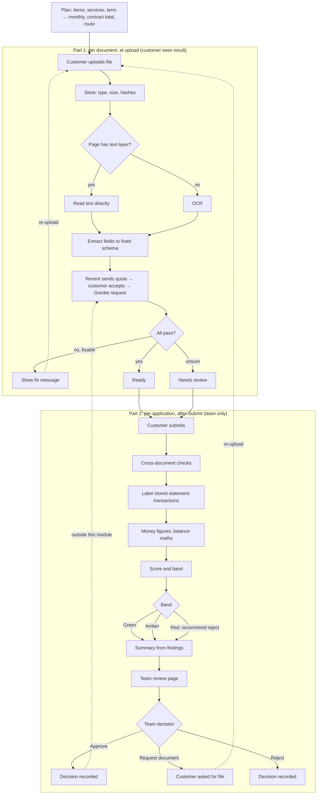

# Architecture

Principle: **AI reads, code decides, people approve.** AI is used only where rules cannot work: turning images into text, filling a fixed form from messy text, labelling bank transactions, and writing the summary. Every check, number, score and band is plain TypeScript.

## 1. Stack

Matches Revent Business so the module can move into their codebase later.

| Layer | Choice |
|---|---|
| App | One Next.js 16 app (App Router) on the Node.js runtime: pages are the frontend, route handlers are the backend. React 19, TypeScript (strict) |
| UI | Tailwind CSS v4, shadcn/ui, next-intl (EN + AR, `localePrefix: "as-needed"`: English at `/`, Arabic at `/ar`), next-themes. Customer screens only; the team UI is English-only and sits outside `[locale]` |
| Data | Postgres via Drizzle ORM, versioned migrations only. PGlite locally; managed Postgres (Neon) when deployed |
| Files | `FileStore` interface. Local disk in dev, Cloudflare R2 when deployed, Replit Object Storage at Revent go-live (swap the implementation only) |
| PDF / images | pdfjs-dist (read the PDF text layer, behind `PdfTextReader`), pdf-lib (inspect PDFs), sharp (re-encode photos, strip EXIF) |
| Validation | Zod at every boundary (API input, AI output, DB JSON) |
| Tests | Vitest (unit), Playwright (end-to-end) |
| AI | `OcrProvider` and `LlmProvider` interfaces. The concrete provider lives behind them and can be swapped. v1 is built against fake providers first |
| Auth (v1) | One seeded customer and one seeded reviewer. A role switch sets a signed, httpOnly cookie. Every route checks role and ownership on the server; every reviewer action is audit-logged |

**Interfaces and boundaries.** `FileStore`, `OcrProvider`, `LlmProvider` and `PdfTextReader` are TypeScript interfaces defined in `src/kyc/` and passed in as arguments. Their real implementations, and the `sharp`, `pdf-lib` and `pdfjs-dist` libraries, live only in `src/providers/`. This keeps `src/kyc/` pure and testable with fakes.

## 2. Flow



AI steps: OCR, Extract fields, Label transactions, Summary. Everything else is code or people.

### Before KYC: plan and pricing

Pure functions in `src/plan/`, no AI.

- Prices are stored **per term** (24 / 36 / 48 months) for every product and service, not derived from a formula. They match the live site where known. The seed has a few products in each category (Technology, Furniture, Office appliances).
- Line monthly = (product price + selected service prices) × quantity, all at the plan's term. Plan monthly = sum of lines. All in integer fils, excluding VAT.
- VAT (5%) is calculated on the plan monthly total and rounded half-up to whole fils (`src/plan/money.ts`), for display only. Contract total = plan monthly × term.
- Test example: Wireless business headset (AED 30.89) + 65-inch meeting room display (AED 205.92), 36 months = 23,681 fils/month excluding VAT.
- Route = contract total below the threshold in `scoring_settings` → self-disclosure form; otherwise → verification call. Its basis (VAT, services) is an open question in the PRD.
- On Proceed, the application stores term, plan monthly, contract total and route. Part 2 uses the stored plan monthly for `leaseToIncomeBps`.

### Part 1: per document, at upload

```
upload → store file (hash, size, type) → router → extract fields → quick checks → status
                                          │
                     text layer on page? ─┼─ yes → read text directly (free, exact)
                                          └─ no  → OCR
```

1. **Store.** Reject wrong type (checked by file content, not extension), over the size limit (default 10 MB), over the page limit (default 30 pages), password-protected, or containing scripts or attachments. The limits are upload safety settings in `src/config/limits.ts`, read from env with those defaults (not risk settings). Re-encode images with sharp. Save SHA-256 and a perceptual hash.
2. **Route per page.** Page has a text layer → read it with `PdfTextReader` (pdfjs-dist). No text layer (photo, scan, image saved as PDF) → OCR.
3. **Extract.** The LLM fills a fixed Zod schema for the slot's document type. Every field carries `value`, `page`, `confidence` (stored as integer bps). Output that fails the schema = extraction failed → "Needs review". For bank statements, transaction rows are extracted here too (needed by `STMT_BALANCE`), because full page text is never stored (§4).
4. **Quick checks** (section 3, stage `upload`).
5. **Status** = Ready / Needs a fix / Needs review (PRD §5).

### Part 2: per application, after Submit

```
cross-document checks → statement transactions → money figures → score + band → summary → review page
```

0. **Completeness gate.** Submit is refused (UI disabled, and the server returns the list of missing slots) until every required slot has a file. Required slots: trade licence, tax certificate, bank statements, passport, Emirates ID front, Emirates ID back, and the self-disclosure form when the route is self-disclosure. No score is computed for an incomplete application. Submit sets `submitted_at`.
1. Cross-document checks (section 3, stage `submit`).
2. Bank statements: label the stored transactions (section 4), reconcile balances in code.
3. Compute money figures (section 4).
4. Score and band (section 5).
5. Summary: the LLM receives **only computed findings** (never raw documents) and fills a fixed schema. If it fails, a code template produces the summary instead.
6. Save the assessment. The team acts on the review page.

**Request document** → the customer gets a message → re-uploads → Part 1 runs → resubmits → Part 2 runs again. Old assessments are kept.

### Processing model (v1)

No job queue. Upload returns at once with status `processing`. The client calls `POST /api/documents/:id/process` and polls the status. Submit calls `POST /api/applications/:id/assess` the same way. A run that times out marks the item `failed` with a retry. Add a queue only if timeouts are seen in practice (log it in §9).

## 3. Check catalogue

Every check is one file in `src/kyc/checks/` and returns the same shape:

```ts
type CheckResult = {
  code: string;                       // e.g. "DOC_EXPIRED"
  status: "pass" | "warn" | "fail" | "skipped";
  detail: string;                     // English, for reviewers only
  evidence?: { documentId: string; page: number };
  customerMessageKey?: string;        // i18n key (EN + AR), only if the customer can fix it
};
```

Customers only ever see the text behind `customerMessageKey`. `detail` is never shown to customers.

**Dates.** Calendar dates are date-only in Asia/Dubai. "Today" is today's date in Dubai. The application date is `submitted_at` (converted to a Dubai date).

Thresholds marked _(setting)_ live in `scoring_settings`. All are **starting values, to be calibrated against reviewer decisions**.

| Code | Stage | Rule | Fail means |
|---|---|---|---|
| `FILE_DUPLICATE` | upload | Same SHA-256 or near-identical perceptual hash already in this application | Needs a fix |
| `FILE_REUSED` | upload | Same SHA-256 seen in another customer's application | Warn → team |
| `DOC_UNREADABLE` | upload | Too little text, or image below minimum resolution / too blurry | Needs a fix |
| `DOC_WRONG_TYPE` | upload | Document fingerprints don't match the slot (e.g. no IBAN on a "statement", EID front in back slot) | Needs a fix |
| `DOC_EXPIRED` | upload | Expiry date before today (Dubai) | Needs a fix |
| `DOC_EXPIRES_SOON` | upload | Expires within `expiresSoonDays` _(setting, 60)_ days | Warn → team |
| `ID_FORMAT` | upload | Emirates ID starts 784 (15 digits), TRN 15 digits, IBAN starts AE with valid checksum | Warn → team |
| `STMT_BALANCE` | upload | Each row: previous balance + in − out = balance; statement: opening + in − out = closing | Warn → team (could be misread or edited) |
| `STMT_COVERAGE` | upload, re-run at submit | Statements together cover the `statementMonthsRequired` _(setting, 6)_ full calendar months before the submit month. At upload (not yet submitted) the current Dubai month stands in for the submit month | Needs a fix ("add October") |
| `STMT_CONTINUITY` | submit | Closing balance of month N = opening balance of month N+1 | Warn → team |
| `NAME_COMPANY` | submit | Company name matches across licence, tax certificate, statements and what was typed | Warn → team |
| `NAME_SIGNATORY` | submit | Signatory on licence matches passport and Emirates ID | Warn → team |
| `LICENCE_NUMBER` | submit | Licence number on document = number typed | Warn → team |
| `TRN_NUMBER` | submit | TRN typed in Company details = TRN on the tax certificate (VAT or Corporate Tax). Skipped when no TRN was typed (the field is optional) | Warn → team |
| `EMAIL_DOMAIN` | submit | Applicant's work email and signatory's signing email: domains match each other and relate to the company name. Free webmail (gmail, outlook…) is noted, not failed | Warn → team |

Name matching: lower-case, standard spellings (Mohammed / Muhammad / Mohd), drop legal suffixes (LLC, L.L.C., FZE, FZCO, DMCC), compare Arabic text when both sides have it. A name mismatch is never a hard stop.

## 4. Bank statements

**Transaction labels (v1):**

| Label | Used for |
|---|---|
| `customer_income` | Monthly income |
| `own_transfer_or_loan_in` | Excluded from income |
| `debt_repayment` | Existing monthly obligations (loans, other leases) |
| `returned_item` | Bounced cheques, returned direct debits |
| `other` | Ignored in v1 |

The LLM proposes a label per row. Code does all arithmetic.

**Stored per transaction:** date (Dubai, date-only), amount (signed integer fils: + in, − out), balance (fils), label, page number, and a description cut to 80 characters with account and card numbers masked. Full page text is never stored.

**Money figures** (money in integer fils, ratios in integer basis points, per calendar month):

| Figure | Definition |
|---|---|
| `monthsCovered` | Full calendar months present |
| `avgMonthlyIncome` | Mean of monthly `customer_income`: summed in fils, divided and rounded half-up at the end |
| `leaseToIncomeBps` | Plan monthly amount ÷ `avgMonthlyIncome`, in bps. `null` if income is 0 |
| `lowestBalance` | Minimum daily closing balance |
| `daysBelowZero` | Days with closing balance < 0 |
| `returnedItems` | Count of `returned_item` |
| `existingDebtMonthly` | Mean monthly `debt_repayment`, rounded half-up at the end |
| `debtToIncomeBps` | `existingDebtMonthly` ÷ `avgMonthlyIncome`, in bps. `null` if income is 0 |

If `avgMonthlyIncome` is 0, both ratios are `null`, their sub-scores are 0, and the reason "No customer income found" (`NO_CUSTOMER_INCOME`) is added. Ratios are never compared as floats. Rounding helpers live in `src/plan/money.ts`.

## 5. Scoring

Score 0–100, higher = safer. All weights and thresholds live in the `scoring_settings` table, versioned. Each assessment stores the settings version it used. **Every weight and threshold below is a starting value, to be calibrated against reviewer decisions.**

**Hard stops** (band is Red whatever the score): expired licence; `STMT_BALANCE` mismatch on more than `balanceMismatchHardStopCount` _(setting, 1)_ statement; `DOC_WRONG_TYPE` unresolved for a required document.

**Blocks:**

| Block | Weight | From |
|---|---|---|
| Documents complete and readable | 15 | Upload checks |
| Identity and name consistency | 25 | `NAME_*`, `LICENCE_NUMBER`, `TRN_NUMBER`, `ID_FORMAT`, `EMAIL_DOMAIN` |
| Financial health | 50 | Money figures (sub-scores below) |
| Statement integrity | 10 | `STMT_*` |

**Financial health sub-scores** (each gives full, half or zero of its weight):

| Sub-score | Weight | Full | Half | Zero |
|---|---|---|---|---|
| `leaseToIncomeBps` | 20 | ≤ 1500 (15%) | 1501–3000 | > 3000 (30%), or `null` |
| `daysBelowZero` | 15 | 0 | 1–5 | > 5 |
| `returnedItems` | 10 | 0 | 1–2 | ≥ 3 |
| `debtToIncomeBps` | 5 | ≤ 2000 (20%) | 2001–4000 | > 4000 (40%), or `null` |

Each block result is stored in bps of its weight (10000 = full). Score = Σ (weight × block bps ÷ 10000), rounded half-up to a whole number.

**Overall confidence** = the lowest block confidence, in bps.

**Bands:** ≥ 75 Green · 50–74 Amber · < 50 Red ("Recommend reject"). If overall confidence < `confidenceFloorBps` _(setting, 7000 = 0.7)_ → at least Amber.

The 0.9 field-confidence target in §8 is an evaluation target only, not runtime logic.

**Output saved per assessment** (example; the numbers fit the rules above):

```json
{
  "applicationId": "app_123",
  "score": 74,
  "band": "AMBER",
  "settingsVersion": 3,
  "confidenceBps": 8200,
  "hardStops": [],
  "blocks": { "documents": 10000, "identity": 5600, "financial": 7000, "integrity": 10000 },
  "reasons": [{ "code": "NAME_SIGNATORY", "status": "warn", "detail": "...", "evidence": { "documentId": "doc_9", "page": 1 } }],
  "figures": {
    "monthsCovered": 6,
    "planMonthly": 23681,
    "avgMonthlyIncome": 4500000,
    "leaseToIncomeBps": 53,
    "daysBelowZero": 3,
    "returnedItems": 2,
    "existingDebtMonthly": 1125000,
    "debtToIncomeBps": 2500
  },
  "summary": "...",
  "createdAt": "2026-11-10T10:15:00Z"
}
```

How the example adds up: lease 23,681 ÷ 4,500,000 = 52.6 bps → 53 (full, 20). 3 days below zero → half (7.5). 2 returned items → half (5). Debt 2500 bps → half (2.5). Financial = 35 of 50 = 7000 bps. Score = 15 + 14 (25 × 5600 bps) + 35 + 10 = 74 → Amber.

## 6. Data model

| Table | Holds |
|---|---|
| `products` | Name, category (Technology / Furniture / Office appliances), specs, `isDemoPrice` |
| `services` | Name, description |
| `prices` | Product or service, term (24 / 36 / 48), monthly fils |
| `users` | Seeded customer and reviewer; role (`customer` / `reviewer`) |
| `applications` | Owner (customer user), applicant (name, work email, mobile; pre-filled from the seeded applicant), company details typed (name, licence number, year established, issuing authority, emirate, legal form, TRN, registered address, deliver to registered address), signatory (is the applicant, full name, signing email, mobile), term, plan monthly (fils), contract total (fils), route, status, `submitted_at` |
| `plan_items` | Application, product, quantity, selected services |
| `documents` | Slot, file key, hashes, page count, status, extracted fields (JSON) |
| `check_results` | One row per check per run |
| `transactions` | Date, amount (signed fils), balance, label, page, description (≤ 80 chars, account and card numbers masked) |
| `assessments` | The output above |
| `review_actions` | Who, action, reason, timestamp |
| `audit_log` | Who, what, when for every document view or download and every reviewer action |
| `scoring_settings` | Versioned risk weights and thresholds: block weights, financial sub-score weights and bands, band cut-offs, `confidenceFloorBps`, `expiresSoonDays`, `statementMonthsRequired`, `balanceMismatchHardStopCount`, route threshold |

Upload safety limits (max file size, max pages) are **not** in `scoring_settings`; they are in `src/config/limits.ts`, read from env with defaults of 10 MB and 30 pages.

## 7. Folder layout

```
src/
  app/                    Next.js pages and route handlers only (thin)
    [locale]/plan/
    [locale]/kyc/                 hub
    [locale]/kyc/account/
    [locale]/kyc/company/
    [locale]/kyc/documents/
    [locale]/kyc/signatory/
    [locale]/kyc/self-disclosure/
    [locale]/kyc/review/
    team/applications/            list (English only, outside [locale])
    team/applications/[id]/       review page (English only)
    api/
  config/
    limits.ts             Upload safety limits from env (defaults 10 MB, 30 pages)
  plan/                   Pricing and route. Pure TypeScript
    money.ts              Half-up rounding, VAT, averages in fils, bps ratios
  kyc/                    The module. Pure TypeScript, no Next.js imports
    interfaces/           FileStore, OcrProvider, LlmProvider, PdfTextReader (types only)
    intake/               store, hash, router
    extraction/           schemas per document type, OCR + LLM calls
    checks/               one file per check
    statements/           transactions, labels, figures
    scoring/              score, band, hard stops
    summary/              LLM summary + template fallback
  providers/              Real implementations of the src/kyc interfaces; the only place sharp, pdf-lib, pdfjs-dist and AI SDKs are imported
  db/                     Drizzle schema, migrations
    seed/                 catalogue, prices, scoring settings, one customer, one reviewer, demo scenarios
messages/                 en.json, ar.json (repo root, next-intl default)
tests/
  fixtures/               synthetic documents only
  kyc/                    unit tests mirror src/kyc
  e2e/
```

Rule: `src/app` calls `src/plan` and `src/kyc`; neither imports from `src/app`. `src/kyc` may import `src/plan` (for `money.ts`). Neither imports `src/db`, `src/providers`, Next.js, `sharp`, `pdf-lib` or `pdfjs-dist`; this is enforced by a lint rule.

Demo scenarios (for example: small plan with clean documents; plan over the route threshold with stretched finances; wrong document plus an edited statement) live only in `src/db/seed/` and `tests/fixtures/`. The pipeline treats them like any other application.

## 8. Evaluation

Run on the labelled test set (30–50 synthetic or anonymised documents, plus deliberately broken copies: one balance edited, a page missing, wrong document in a slot). One command, `npm run eval`, prints the table below. Results are recorded in the decision log whenever a provider, prompt or rule changes.

| Area | Metric | Plain meaning | v1 target |
|---|---|---|---|
| OCR | Character error rate (CER) | % of characters read wrong | < 2% digital PDFs, < 5% photos |
| Extraction | Field exact match | Licence no., TRN, names, dates exactly right | ≥ 98% digital, ≥ 90% photos |
| Extraction | Schema failure rate | AI output that didn't fit the schema | < 2% |
| Classification | Wrong-slot detection | Wrong document in a slot caught | ≥ 95% |
| Transactions | Row recall / row precision | Every row found / no invented rows | ≥ 99% / 100% after balance check |
| Transactions | Label accuracy | Correct label per row | ≥ 90% |
| Integrity | Tamper catch rate | Edited statements flagged | ≥ 90% |
| Integrity | False alarm rate | Clean documents wrongly flagged | < 10% |
| Summary | Faithfulness | Every number in the summary exists in the findings | 100% |
| Decision | Band agreement | Band matches the reviewer's judgement (shadow test) | ≥ 90% |
| Speed | Latency p50 / p95 per document | Time from upload to status | p95 ≤ 15 s |
| Speed | Latency per assessment | Submit to review page ready | ≤ 3 min |
| Cost | Cost per application | AI calls for one full application | Tracked; report per run |

Confidence calibration (evaluation target only, not runtime logic): fields reported with confidence ≥ 0.9 must be correct ≥ 99% of the time. If not, raise the threshold for "Needs review".

## 9. Decision log

How to use: when an approach is tried, add a row. Status moves `trying` → `adopted` or `dropped`, only after its test passes or fails. Never delete rows; dropped ideas stay as a record.

| # | Date | Decision | Why | Test / evidence | Status |
|---|---|---|---|---|---|
| 1 | 2026-11-10 | Read text-layer PDFs directly; OCR only image pages | Cheaper, exact numbers | Compare extraction on 10 digital statements | trying |
| 2 | 2026-11-10 | No job queue in v1 | Simplicity | Measure p95 processing time on deployed app | trying |
| 3 | 2026-11-10 | Summary from findings only, template fallback | No invented numbers | Every number in summary exists in findings | trying |
| 4 | 2026-11-10 | Store prices per term instead of a formula | Equipment follows ×0.72 / ×0.57 but services don't follow a clean factor | Pricing test: Wireless business headset (AED 30.89) + 65-inch meeting room display (AED 205.92), 36 months = 23,681 fils/month excl. VAT | trying |
| 5 | 2026-11-10 | Demo scenarios as seed data only | Results must come from the real pipeline | No scenario names or IDs anywhere in `src/` | trying |
| 6 | 2026-11-10 | Seed data in `src/db/seed/`; messages in `messages/` at the repo root | One location each; `messages/` is the next-intl default | Owner decision | adopted |
| 7 | 2026-11-10 | `FileStore`, `OcrProvider`, `LlmProvider`, `PdfTextReader` interfaces in `src/kyc`, passed in; implementations, sharp, pdf-lib, pdfjs-dist in `src/providers` | Keeps `src/kyc` pure and testable with fakes | Lint rule blocks those imports in `src/kyc` and `src/plan` | adopted |
| 8 | 2026-11-10 | Risk thresholds in `scoring_settings` (`expiresSoonDays` 60, `statementMonthsRequired` 6, `confidenceFloorBps` 7000, `balanceMismatchHardStopCount` 1); upload limits in `src/config/limits.ts` from env (10 MB, 30 pages); 0.9 calibration is eval-only | Risk settings change without code; safety limits are ops settings | Owner decision | adopted |
| 9 | 2026-11-10 | Team UI English-only in v1, outside `[locale]`; `detail` and summary in English; customers see only `customerMessageKey` text (EN + AR) | Reviewers work in English; customers need both | Owner decision | adopted |
| 10 | 2026-11-10 | §5 example made consistent: lease 23,681 fils, income 4,500,000 fils, `leaseToIncomeBps` 53 | Example must follow the rules | Worked sum under §5 gives 74 → Amber | adopted |
| 11 | 2026-11-10 | next-intl `localePrefix: "as-needed"`: English at `/`, Arabic at `/ar` | Matches the PRD URLs | Owner decision | adopted |
| 12 | 2026-11-10 | Submit blocked until every required slot has a file (UI disabled and server rejects with missing slots); no score for incomplete applications | A score on missing documents is meaningless | Owner decision | adopted |
| 13 | 2026-11-10 | Financial health sub-scores: lease/income 20, days below zero 15, returned items 10, debt/income 5 (full / half / zero bands); overall confidence = lowest block confidence. Starting values, to be calibrated | Defines the 50-point block | Owner decision | adopted |
| 14 | 2026-11-10 | All ratios stored as integer bps; income 0 → `leaseToIncomeBps` null, sub-score 0, reason "No customer income found" | No float comparisons; no division by zero | Owner decision | adopted |
| 15 | 2026-11-10 | VAT 5% on the monthly total, rounded half-up to whole fils; averages summed in fils and rounded half-up at the end; both in `src/plan/money.ts` | One rounding rule, in one place | Unit tests in `tests/plan/` | adopted |
| 16 | 2026-11-10 | Calendar dates are date-only in Asia/Dubai; application date = `submitted_at`; statements cover the 6 full calendar months before the submit month | Removes month-boundary ambiguity | Owner decision | adopted |
| 17 | 2026-11-10 | Plans at or above the threshold: hub shows "x of 4", review page shows a "Verification call" card; nothing else built for that route | Keeps v1 scope small | Owner decision | adopted |
| 18 | 2026-11-10 | One role, `reviewer` (replaces "finance"); seeded customer and reviewer; signed httpOnly cookie for the role switch; role and ownership checked on the server for every route; every reviewer action audit-logged | Simple but safe access model for v1 | Owner decision | adopted |
| 19 | 2026-11-10 | Build against fake AI providers first; pdfjs-dist reads the PDF text layer | Pipeline and tests don't depend on a paid provider | Owner decision | adopted |
| 20 | 2026-11-10 | Seed a few products per category with prices per term; the headset + display example replaces the earlier multi-term example | One clear, testable pricing example | Pricing test in row 4 | adopted |
| 21 | 2026-11-10 | Per transaction keep date, amount, balance, label, page, description ≤ 80 chars with account and card numbers masked; never store full page text. Transactions are therefore extracted at upload | Store the minimum (SECURITY §1); `STMT_BALANCE` runs at upload | Owner decision | adopted |
| 22 | 2026-11-10 | "Your account" pre-filled from the seeded applicant | No sign-up in v1 | Owner decision | adopted |
| 23 | 2026-11-10 | No attribution lines in commits or PRs | Owner preference | Owner decision | adopted |
| 24 | 2026-11-12 | Browser (e2e) tests run against a production build on port 3100, not the dev server | The dev server builds pages on first visit; 3 parallel workers on a cold start got a half-built page (`Unexpected end of JSON input`) once in 3 runs. A production build also caught the PGlite bundling bug the dev server hid | Full e2e suite (13 tests) passed twice in a row on the production build | adopted |
| 25 | 2026-11-12 | The module ends at the score card. Review actions only record the reviewer's decision (audit log); quote, Grenke request and Grenke KYC are outside the module | Matches Revent's real flow: Submit → Revent quotes within 1 working day → customer accepts → Grenke request | Owner decision | adopted |
| 26 | 2026-11-12 | KYC screens follow the live site's fields: company year established, legal form, optional TRN, registered address, delivery tick box; VAT or Corporate Tax certificate; signatory tick box and optional mobile. Year established is not scored | Typed values and documents must match what customers actually see | Owner decision, from live-site screenshots | adopted |
| 27 | 2026-11-12 | New check `TRN_NUMBER`: typed TRN = TRN on the tax certificate | Same cross-check as `LICENCE_NUMBER`, now that the TRN is typed | Owner decision; tests come with the check | adopted |

## 10. Later (not v1)

- Investigator agent for Amber cases (read-only lookups, writes evidence notes).
- Follow-up agent that drafts document requests for a person to send.
- Weekly report comparing scores with team decisions to suggest threshold changes.
- Registry checks (licence, TRN) and bank connections instead of uploaded statements.
