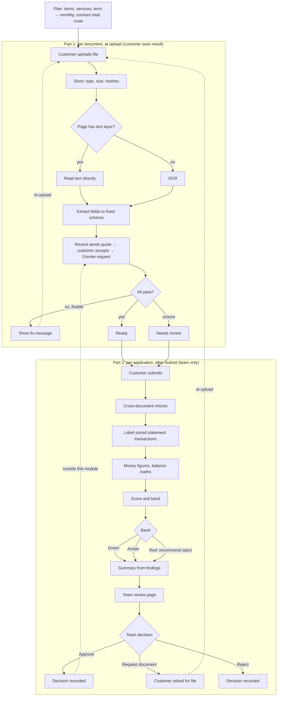

# Architecture

Principle: **AI reads, code decides, people approve.** AI is used only where rules cannot work: turning images into text, filling a fixed form from messy text, labelling bank transactions, and writing the reviewer insights. Every check, number, score and band is plain TypeScript.

## 1. Stack

Matches Revent Business so the module can move into their codebase later.

| Layer | Choice |
|---|---|
| App | One Next.js 16 app (App Router) on the Node.js runtime: pages are the frontend, route handlers are the backend. React 19, TypeScript (strict) |
| UI | Tailwind CSS v4, shadcn/ui, next-intl (EN + AR, `localePrefix: "as-needed"`: English at `/`, Arabic at `/ar`), next-themes. Customer screens only; the team UI is English-only and sits outside `[locale]` |
| Data | Postgres via Drizzle ORM, versioned migrations only. PGlite locally; managed Postgres (Neon) when deployed |
| Files | `FileStore` interface. Local disk in dev, Cloudflare R2 when deployed, Replit Object Storage at Revent go-live (swap the implementation only) |
| PDF / images | pdfjs-dist (read the PDF text layer, behind `PdfTextReader`), pdf-lib (inspect PDFs), sharp (re-encode photos, strip EXIF) |
| Validation | Zod at every boundary (API input, AI output, DB JSON) |
| Tests | Vitest (unit), Playwright (end-to-end) |
| AI | `OcrProvider` and `LlmProvider` interfaces. The concrete provider lives behind them and can be swapped. v1 is built against fake providers first |
| Auth (v1) | One seeded customer and one seeded reviewer. A role switch sets a signed, httpOnly cookie. Every route checks role and ownership on the server; every reviewer action is audit-logged |

**Interfaces and boundaries.** `FileStore`, `OcrProvider`, `LlmProvider`, `PdfTextReader`, `PdfInspector` (page count, encryption, active content; pdf-lib) and `ImageProcessor` (re-encode, strip EXIF, picture fingerprint; sharp) are TypeScript interfaces defined in `src/kyc/interfaces/` and passed in as arguments. Their real implementations, and the `sharp`, `pdf-lib` and `pdfjs-dist` libraries, live only in `src/providers/`. This keeps `src/kyc/` pure and testable with fakes.

## 2. Flow



AI steps: OCR, Extract fields, Label transactions, Insights. Everything else is code or people.

### Before KYC: plan and pricing

Pure functions in `src/plan/`, no AI.

- Prices are stored **per term** (24 / 36 / 48 months) for every product and service, not derived from a formula. They match the live site where known. The seed has a few products in each category (Technology, Furniture, Office appliances).
- Line monthly = (product price + selected service prices) × quantity, all at the plan's term. Plan monthly = sum of lines. All in integer fils, excluding VAT.
- VAT (5%) is calculated on the plan monthly total and rounded half-up to whole fils (`src/plan/money.ts`), for display only. Contract total = plan monthly × term.
- Test example: Wireless business headset (AED 30.89) + 65-inch meeting room display (AED 205.92), 36 months = 23,681 fils/month excluding VAT.
- Route = contract total below the threshold in `scoring_settings` → self-disclosure form; otherwise → verification call. Its basis (VAT, services) is an open question in the PRD.
- On Proceed, the application stores term, plan monthly, contract total and route. Part 2 uses the stored plan monthly for `leaseToIncomeBps`.

### Part 1: per document, at upload

```
upload → store file (hash, size, type) → router → extract fields → quick checks → status
                                          │
                     text layer on page? ─┼─ yes → read text directly (free, exact)
                                          └─ no  → OCR
```

1. **Store.** Reject wrong type (checked by file content, not extension), over the size limit (default 10 MB), over the page limit (default 30 pages), password-protected, or containing scripts or attachments. The limits are upload safety settings in `src/config/limits.ts`, read from env with those defaults (not risk settings). Re-encode images with sharp. Save SHA-256 and a perceptual hash.
2. **Route per page.** Page has a text layer → read it with `PdfTextReader` (pdfjs-dist). No text layer (photo, scan, image saved as PDF) → OCR.
3. **Extract.** The LLM fills a fixed Zod schema for the slot's document type. Every field carries `value`, `page`, `confidence` (stored as integer bps). Output that fails the schema = extraction failed → "Needs review". For bank statements, transaction rows are extracted here too (needed by `STMT_BALANCE`), because full page text is never stored (§4).
4. **Quick checks** (section 3, stage `upload`).
5. **Status** = Ready / Needs a fix / Needs review (PRD §5).

### Part 2: per application, after Submit

```
cross-document checks → statement transactions → money figures → score + band → insights → review page
```

0. **Completeness gate.** Submit is refused (UI disabled, and the server returns the list of what is missing) until every required slot has a file and the Company details and Authorised signatory forms are saved. Required slots: trade licence, tax certificate, bank statements, passport, Emirates ID front, Emirates ID back, and the self-disclosure form when the route is self-disclosure. A file waiting for a fix counts as a file. No score is computed for an incomplete application. Submit sets `status = submitted` and `submitted_at`; after that, uploads and form saves are refused.
1. Cross-document checks (section 3, stage `submit`).
2. Bank statements: label the stored transactions (section 4), reconcile balances in code.
3. Compute money figures (section 4).
4. Score and band (section 5).
5. Insights: the LLM receives **only computed findings** (score, band, check results, money figures, licence activities; never raw documents or page text) and fills a fixed schema: `profile` (2–3 sentences), `patterns` (≤ 4, each with the finding it rests on and its evidence), `thingsToCheck` (≤ 3). Code rejects the output if it has a number not in the findings or evidence that does not exist; then a code template writes a plain profile and lists the failed checks instead (PRD §6, decision log 50).
6. Save the assessment. The team acts on the review page.

**Request document** → the customer gets a message → re-uploads → Part 1 runs → resubmits → Part 2 runs again. Old assessments are kept.

### Processing model (v1)

No job queue. `POST /api/applications/:id/documents` stores the file and returns at once with status `checking`. The client then calls `POST /api/documents/:id/process`, which runs the checks and answers with the status and customer message keys (no polling needed while one request stays inside the 15 s budget). A file still `checking` after a page reload is shown as failed, so the customer uploads it again. Submit calls `POST /api/applications/:id/assess` the same way. A run that times out marks the item `failed` with a retry. Add a queue only if timeouts are seen in practice (log it in §9). Submit runs Part 2 in the same request, after the application is marked submitted, and saves it as a new `assessments` row; if Part 2 fails, the Submit still stands and the failure is logged without document values.

## 3. Check catalogue

Every check is one file in `src/kyc/checks/` and returns the same shape:

```ts
type CheckResult = {
  code: string;                       // e.g. "DOC_EXPIRED"
  status: "pass" | "warn" | "fail" | "skipped";
  detail: string;                     // English, for reviewers only
  evidence?: { documentId: string; page: number };
  customerMessageKey?: string;        // i18n key (EN + AR), only if the customer can fix it
};
```

Customers only ever see the text behind `customerMessageKey`. `detail` is never shown to customers.

**Dates.** Calendar dates are date-only in Asia/Dubai. "Today" is today's date in Dubai. The application date is `submitted_at` (converted to a Dubai date).

Thresholds marked _(setting)_ live in `scoring_settings`. All are **starting values, to be calibrated against reviewer decisions**.

| Code | Stage | Rule | Fail means |
|---|---|---|---|
| `FILE_DUPLICATE` | upload | Same SHA-256 or near-identical perceptual hash already in this application | Needs a fix |
| `FILE_REUSED` | upload | Same SHA-256 seen in another customer's application | Warn → team |
| `DOC_UNREADABLE` | upload | Too little text, or image below minimum resolution / too blurry | Needs a fix |
| `DOC_WRONG_TYPE` | upload | Document fingerprints don't match the slot (e.g. no IBAN on a "statement", EID front in back slot) | Needs a fix |
| `DOC_EXPIRED` | upload | Expiry date before today (Dubai) | Needs a fix |
| `DOC_EXPIRES_SOON` | upload | Expires within `expiresSoonDays` _(setting, 60)_ days | Warn → team |
| `PASSPORT_MRZ` | upload | Every check digit in the passport's machine-readable lines is correct. Expiry is taken from these lines when the printed date was not read | Needs a fix (clearer photo) |
| `ID_FORMAT` | upload | Emirates ID starts 784 (15 digits), TRN 15 digits, IBAN starts AE with valid checksum | Warn → team |
| `STMT_BALANCE` | upload | Each row: previous balance + in − out = balance; statement: opening + in − out = closing | Warn → team (could be misread or edited) |
| `STMT_COVERAGE` | upload, re-run at submit | Statements together cover the `statementMonthsRequired` _(setting, 6)_ full calendar months before the submit month. At upload (not yet submitted) the current Dubai month stands in for the submit month | Needs a fix ("add October") |
| `STMT_CONTINUITY` | submit | Closing balance of month N = opening balance of month N+1, in whole fils, for back-to-back statements of the same account | Warn → team |
| `IBAN_CONSISTENT` | submit | Every statement has the same IBAN (never repeated in the detail) | Warn → team |
| `STMT_CURRENCY` | submit | Every statement is in AED; others are left out of the money figures. A currency not read counts as AED | Warn → team |
| `NAME_COMPANY` | submit | Company name matches across licence, tax certificate, statements and what was typed | Warn → team |
| `NAME_SIGNATORY` | submit | Names in the signatory form, passport and Emirates ID front agree, and the signatory is among the managers on the licence (else "authority not proven"). Names are never quoted in the detail | Warn → team |
| `EMIRATE_MATCH` | submit | Emirate on the licence = emirate typed | Warn → team |
| `EID_SIDES_MATCH` | submit | Emirates ID front and back (machine-readable lines) agree on ID number, expiry and name | Warn → team |
| `DOB_MATCH` | submit | Date of birth in the passport's and Emirates ID's machine-readable lines is the same | Warn → team |
| `NATIONALITY_MATCH` | submit | Nationality in the same two places is the same. Shown only, never scored | Warn → team |
| `EID_EMPLOYER` | submit | Employer on the Emirates ID back is this company. Shown only, never scored | Warn → team |
| `LICENCE_NUMBER` | submit | Licence number on document = number typed | Warn → team |
| `TRN_NUMBER` | submit | TRN typed in Company details = TRN on the tax certificate (VAT or Corporate Tax). Skipped when no TRN was typed (the field is optional) | Warn → team |

Name matching: see `docs/document-specs/cross-checks.md` §3 (clean-up plus per-word Jaro-Winkler for people; exact after dropping UAE legal forms for companies; Arabic compared with Arabic only). A name mismatch is never a hard stop.

The full set of submit-stage cross-checks for v1, including the new ones (`EMIRATE_MATCH`, `EID_SIDES_MATCH`, `DOB_MATCH`, `NATIONALITY_MATCH`, `EID_EMPLOYER`, `IBAN_CONSISTENT`, `STMT_CURRENCY`) and the fields they need, is specified in `docs/document-specs/cross-checks.md`. Rows move into this table as they are built.

## 4. Bank statements

**Transaction labels (v1):**

| Label | Used for |
|---|---|
| `customer_income` | Monthly income |
| `own_transfer_or_loan_in` | Excluded from income |
| `debt_repayment` | Existing monthly obligations (loans, other leases) |
| `returned_item` | Bounced cheques, returned direct debits |
| `other` | Ignored in v1 |

The LLM proposes a label per row, and for `customer_income` rows the payer's name as written. Code does all arithmetic, including grouping income by payer.

**Stored per transaction:** date (Dubai, date-only), amount (signed integer fils: + in, − out), balance (fils), label, payer (income rows only), page number, and a description cut to 80 characters with account and card numbers masked. Full page text is never stored.

**Money figures** (money in integer fils, ratios in integer basis points, per calendar month):

| Figure | Definition |
|---|---|
| `monthsCovered` | Full calendar months present |
| `avgMonthlyIncome` | Mean of monthly `customer_income`: summed in fils, divided and rounded half-up at the end |
| `leaseToIncomeBps` | Plan monthly amount ÷ `avgMonthlyIncome`, in bps. `null` if income is 0 |
| `lowestBalance` | Minimum daily closing balance |
| `daysBelowZero` | Days with closing balance < 0 |
| `returnedItems` | Count of `returned_item` |
| `existingDebtMonthly` | Mean monthly `debt_repayment`, rounded half-up at the end |
| `debtToIncomeBps` | `existingDebtMonthly` ÷ `avgMonthlyIncome`, in bps. `null` if income is 0 |
| `topPayerShareBps` | Income from the largest payer ÷ all `customer_income`, in bps. `null` if income is 0. Shown and used by the insights; **not scored** |
| `largestBalanceDropBps` | Largest fall from one month's closing balance to the next, as bps of the earlier balance (only when that balance is above 0). Shown and used by the insights; **not scored** |

If `avgMonthlyIncome` is 0, both ratios are `null`, their sub-scores are 0, and the reason "No customer income found" (`NO_CUSTOMER_INCOME`) is added. Ratios are never compared as floats. Rounding helpers live in `src/plan/money.ts`.

## 5. Scoring

Score 0–100, higher = safer. All weights and thresholds live in the `scoring_settings` table, versioned. Each assessment stores the settings version it used. **Every weight and threshold below is a starting value, to be calibrated against reviewer decisions.**

**Hard stops** (band is Red whatever the score): expired licence; `STMT_BALANCE` mismatch on more than `balanceMismatchHardStopCount` _(setting, 1)_ statement; `DOC_WRONG_TYPE` unresolved for a required document.

**Blocks:**

| Block | Weight | From |
|---|---|---|
| Documents complete and readable | 15 | Upload checks |
| Identity and name consistency | 25 | `NAME_*`, `LICENCE_NUMBER`, `TRN_NUMBER`, `ID_FORMAT` |
| Financial health | 50 | Money figures (sub-scores below) |
| Statement integrity | 10 | `STMT_*` |

**Financial health sub-scores** (each gives full, half or zero of its weight):

| Sub-score | Weight | Full | Half | Zero |
|---|---|---|---|---|
| `leaseToIncomeBps` | 20 | ≤ 1500 (15%) | 1501–3000 | > 3000 (30%), or `null` |
| `daysBelowZero` | 15 | 0 | 1–5 | > 5 |
| `returnedItems` | 10 | 0 | 1–2 | ≥ 3 |
| `debtToIncomeBps` | 5 | ≤ 2000 (20%) | 2001–4000 | > 4000 (40%), or `null` |

Each block result is stored in bps of its weight (10000 = full). Score = Σ (weight × block bps ÷ 10000), rounded half-up to a whole number.

**Overall confidence** = the lowest block confidence, in bps.

**Bands:** ≥ 75 Green · 50–74 Amber · < 50 Red ("Recommend reject"). If overall confidence < `confidenceFloorBps` _(setting, 7000 = 0.7)_ → at least Amber.

The 0.9 field-confidence target in §8 is an evaluation target only, not runtime logic.

**Output saved per assessment** (example; the numbers fit the rules above):

```json
{
  "applicationId": "app_123",
  "score": 74,
  "band": "AMBER",
  "settingsVersion": 3,
  "confidenceBps": 8200,
  "hardStops": [],
  "blocks": { "documents": 10000, "identity": 5600, "financial": 7000, "integrity": 10000 },
  "reasons": [{ "code": "NAME_SIGNATORY", "status": "warn", "detail": "...", "evidence": { "documentId": "doc_9", "page": 1 } }],
  "figures": {
    "monthsCovered": 6,
    "planMonthly": 23681,
    "avgMonthlyIncome": 4500000,
    "leaseToIncomeBps": 53,
    "daysBelowZero": 3,
    "returnedItems": 2,
    "existingDebtMonthly": 1125000,
    "debtToIncomeBps": 2500
  },
  "insights": { "profile": "...", "patterns": [{ "text": "...", "evidence": { "documentId": "doc_4", "page": 2 } }], "thingsToCheck": ["..."], "source": "llm" },
  "createdAt": "2026-11-10T10:15:00Z"
}
```

How the example adds up: lease 23,681 ÷ 4,500,000 = 52.6 bps → 53 (full, 20). 3 days below zero → half (7.5). 2 returned items → half (5). Debt 2500 bps → half (2.5). Financial = 35 of 50 = 7000 bps. Score = 15 + 14 (25 × 5600 bps) + 35 + 10 = 74 → Amber.

## 6. Data model

| Table | Holds |
|---|---|
| `products` | Name, category (Technology / Furniture / Office appliances), specs, `isDemoPrice` |
| `services` | Name, description |
| `prices` | Product or service, term (24 / 36 / 48), monthly fils |
| `users` | Seeded customer and reviewer; role (`customer` / `reviewer`) |
| `applications` | Owner (customer user), applicant (name, work email, mobile; pre-filled from the seeded applicant), company details typed (name, licence number, year established, issuing authority, emirate, legal form, TRN, registered address, deliver to registered address), signatory (is the applicant, full name, signing email, mobile), term, plan monthly (fils), contract total (fils), route, status, `submitted_at` |
| `plan_items` | Application, product, quantity, selected services |
| `documents` | Application, slot, file key (random name), file kind, size, page count, SHA-256, picture fingerprint, image width and height, status (`checking` / `ready` / `needs_fix` / `needs_review` / `failed`), extracted fields (JSON), `replacedAt`. The original file name is not stored. A new upload in a one-file box marks the old row replaced instead of deleting it |
| `check_results` | One row per check per run: code, status, reviewer detail, evidence page, customer message key |
| `transactions` | Date, amount (signed fils), balance, label, page, description (≤ 80 chars, account and card numbers masked) |
| `assessments` | The output above |
| `review_actions` | Who, action, reason, timestamp |
| `audit_log` | Who, what, when for every document view or download and every reviewer action |
| `scoring_settings` | Versioned risk weights and thresholds: block weights, financial sub-score weights and bands, band cut-offs, `confidenceFloorBps`, `expiresSoonDays`, `statementMonthsRequired`, `balanceMismatchHardStopCount`, route threshold |

Upload safety limits (max file size, max pages) are **not** in `scoring_settings`; they are in `src/config/limits.ts`, read from env with defaults of 10 MB and 30 pages.

## 7. Folder layout

```
src/
  app/                    Next.js pages and route handlers only (thin)
    [locale]/plan/
    [locale]/kyc/                 hub
    [locale]/kyc/account/
    [locale]/kyc/company/
    [locale]/kyc/documents/
    [locale]/kyc/signatory/
    [locale]/kyc/self-disclosure/
    [locale]/kyc/review/
    team/applications/            list (English only, outside [locale])
    team/applications/[id]/       review page (English only)
    api/
  config/
    limits.ts             Upload safety limits from env (defaults 10 MB, 30 pages)
  plan/                   Pricing and route. Pure TypeScript
    money.ts              Half-up rounding, VAT, averages in fils, bps ratios
  kyc/                    The module. Pure TypeScript, no Next.js imports
    interfaces/           FileStore, OcrProvider, LlmProvider, PdfTextReader, PdfInspector, ImageProcessor (types only)
    intake/               store, hash, router
    extraction/           schemas per document type, OCR + LLM calls
    checks/               one file per check
    statements/           transactions, labels, figures
    scoring/              score, band, hard stops
    insights/             LLM insights + template fallback
  providers/              Real implementations of the src/kyc interfaces; the only place sharp, pdf-lib, pdfjs-dist and AI SDKs are imported
  services/               Glue for one use case: calls src/kyc and src/plan, reads and writes src/db, gets parts from src/providers (app-services.ts chooses them)
  auth/                   Session cookie, and access checks that limit every lookup to the signed-in customer's own rows
  db/                     Drizzle schema, migrations, plain data functions
    seed/                 catalogue, prices, scoring settings, one customer, one reviewer, demo scenarios
messages/                 en.json, ar.json (repo root, next-intl default)
tests/
  fixtures/               synthetic documents only
  kyc/                    unit tests mirror src/kyc
  e2e/
```

Rule: `src/app` calls `src/plan` and `src/kyc`; neither imports from `src/app`. `src/kyc` may import `src/plan` (for `money.ts`). Neither imports `src/db`, `src/providers`, Next.js, `sharp`, `pdf-lib` or `pdfjs-dist`; this is enforced by a lint rule.

Demo scenarios (for example: small plan with clean documents; plan over the route threshold with stretched finances; wrong document plus an edited statement) live only in `src/db/seed/` and `tests/fixtures/`. The pipeline treats them like any other application.

## 8. Evaluation

Run on the labelled test set (30–50 synthetic or anonymised documents, plus deliberately broken copies: one balance edited, a page missing, wrong document in a slot). One command, `npm run eval`, prints the table below. Results are recorded in the decision log whenever a provider, prompt or rule changes.

| Area | Metric | Plain meaning | v1 target |
|---|---|---|---|
| OCR | Character error rate (CER) | % of characters read wrong | < 2% digital PDFs, < 5% photos |
| Extraction | Field exact match | Licence no., TRN, names, dates exactly right | ≥ 98% digital, ≥ 90% photos |
| Extraction | Schema failure rate | AI output that didn't fit the schema | < 2% |
| Classification | Wrong-slot detection | Wrong document in a slot caught | ≥ 95% |
| Transactions | Row recall / row precision | Every row found / no invented rows | ≥ 99% / 100% after balance check |
| Transactions | Label accuracy | Correct label per row | ≥ 90% |
| Integrity | Tamper catch rate | Edited statements flagged | ≥ 90% |
| Integrity | False alarm rate | Clean documents wrongly flagged | < 10% |
| Insights | Faithfulness | Every number and evidence link in the insights exists in the findings | 100% |
| Decision | Band agreement | Band matches the reviewer's judgement (shadow test) | ≥ 90% |
| Speed | Latency p50 / p95 per document | Time from upload to status | p95 ≤ 15 s |
| Speed | Latency per assessment | Submit to review page ready | ≤ 3 min |
| Cost | Cost per application | AI calls for one full application | Tracked; report per run |

Confidence calibration (evaluation target only, not runtime logic): fields reported with confidence ≥ 0.9 must be correct ≥ 99% of the time. If not, raise the threshold for "Needs review".

## 9. Decision log

How to use: when an approach is tried, add a row. Status moves `trying` → `adopted` or `dropped`, only after its test passes or fails. Never delete rows; dropped ideas stay as a record.

| # | Date | Decision | Why | Test / evidence | Status |
|---|---|---|---|---|---|
| 1 | 2026-11-10 | Read text-layer PDFs directly; OCR only image pages | Cheaper, exact numbers | Compare extraction on 10 digital statements. Refined by row 43: scanned pages with a scanner-made text layer go to OCR too | trying |
| 2 | 2026-11-10 | No job queue in v1 | Simplicity | Measure p95 processing time on deployed app | trying |
| 3 | 2026-11-10 | Summary from findings only, template fallback | No invented numbers | Every number in summary exists in findings | trying |
| 4 | 2026-11-10 | Store prices per term instead of a formula | Equipment follows ×0.72 / ×0.57 but services don't follow a clean factor | Pricing test: Wireless business headset (AED 30.89) + 65-inch meeting room display (AED 205.92), 36 months = 23,681 fils/month excl. VAT | trying |
| 5 | 2026-11-10 | Demo scenarios as seed data only | Results must come from the real pipeline | No scenario names or IDs anywhere in `src/` | trying |
| 6 | 2026-11-10 | Seed data in `src/db/seed/`; messages in `messages/` at the repo root | One location each; `messages/` is the next-intl default | Owner decision | adopted |
| 7 | 2026-11-10 | `FileStore`, `OcrProvider`, `LlmProvider`, `PdfTextReader` interfaces in `src/kyc`, passed in; implementations, sharp, pdf-lib, pdfjs-dist in `src/providers` | Keeps `src/kyc` pure and testable with fakes | Lint rule blocks those imports in `src/kyc` and `src/plan` | adopted |
| 8 | 2026-11-10 | Risk thresholds in `scoring_settings` (`expiresSoonDays` 60, `statementMonthsRequired` 6, `confidenceFloorBps` 7000, `balanceMismatchHardStopCount` 1); upload limits in `src/config/limits.ts` from env (10 MB, 30 pages); 0.9 calibration is eval-only | Risk settings change without code; safety limits are ops settings | Owner decision | adopted |
| 9 | 2026-11-10 | Team UI English-only in v1, outside `[locale]`; `detail` and summary in English; customers see only `customerMessageKey` text (EN + AR) | Reviewers work in English; customers need both | Owner decision | adopted |
| 10 | 2026-11-10 | §5 example made consistent: lease 23,681 fils, income 4,500,000 fils, `leaseToIncomeBps` 53 | Example must follow the rules | Worked sum under §5 gives 74 → Amber | adopted |
| 11 | 2026-11-10 | next-intl `localePrefix: "as-needed"`: English at `/`, Arabic at `/ar` | Matches the PRD URLs | Owner decision | adopted |
| 12 | 2026-11-10 | Submit blocked until every required slot has a file (UI disabled and server rejects with missing slots); no score for incomplete applications | A score on missing documents is meaningless | Owner decision | adopted |
| 13 | 2026-11-10 | Financial health sub-scores: lease/income 20, days below zero 15, returned items 10, debt/income 5 (full / half / zero bands); overall confidence = lowest block confidence. Starting values, to be calibrated | Defines the 50-point block | Owner decision | adopted |
| 14 | 2026-11-10 | All ratios stored as integer bps; income 0 → `leaseToIncomeBps` null, sub-score 0, reason "No customer income found" | No float comparisons; no division by zero | Owner decision | adopted |
| 15 | 2026-11-10 | VAT 5% on the monthly total, rounded half-up to whole fils; averages summed in fils and rounded half-up at the end; both in `src/plan/money.ts` | One rounding rule, in one place | Unit tests in `tests/plan/` | adopted |
| 16 | 2026-11-10 | Calendar dates are date-only in Asia/Dubai; application date = `submitted_at`; statements cover the 6 full calendar months before the submit month | Removes month-boundary ambiguity | Owner decision | adopted |
| 17 | 2026-11-10 | Plans at or above the threshold: hub shows "x of 4", review page shows a "Verification call" card; nothing else built for that route | Keeps v1 scope small | Owner decision | adopted |
| 18 | 2026-11-10 | One role, `reviewer` (replaces "finance"); seeded customer and reviewer; signed httpOnly cookie for the role switch; role and ownership checked on the server for every route; every reviewer action audit-logged | Simple but safe access model for v1 | Owner decision | adopted |
| 19 | 2026-11-10 | Build against fake AI providers first; pdfjs-dist reads the PDF text layer | Pipeline and tests don't depend on a paid provider | Owner decision | adopted |
| 20 | 2026-11-10 | Seed a few products per category with prices per term; the headset + display example replaces the earlier multi-term example | One clear, testable pricing example | Pricing test in row 4 | adopted |
| 21 | 2026-11-10 | Per transaction keep date, amount, balance, label, page, description ≤ 80 chars with account and card numbers masked; never store full page text. Transactions are therefore extracted at upload | Store the minimum (SECURITY §1); `STMT_BALANCE` runs at upload | Owner decision | adopted |
| 22 | 2026-11-10 | "Your account" pre-filled from the seeded applicant | No sign-up in v1 | Owner decision | adopted |
| 23 | 2026-11-10 | No attribution lines in commits or PRs | Owner preference | Owner decision | adopted |
| 24 | 2026-11-12 | Browser (e2e) tests run against a production build on port 3100, not the dev server | The dev server builds pages on first visit; 3 parallel workers on a cold start got a half-built page (`Unexpected end of JSON input`) once in 3 runs. A production build also caught the PGlite bundling bug the dev server hid | Full e2e suite (13 tests) passed twice in a row on the production build | adopted |
| 25 | 2026-11-12 | The module ends at the score card. Review actions only record the reviewer's decision (audit log); quote, Grenke request and Grenke KYC are outside the module | Matches Revent's real flow: Submit → Revent quotes within 1 working day → customer accepts → Grenke request | Owner decision | adopted |
| 26 | 2026-11-12 | KYC screens follow the live site's fields: company year established, legal form, optional TRN, registered address, delivery tick box; VAT or Corporate Tax certificate; signatory tick box and optional mobile. Year established is not scored | Typed values and documents must match what customers actually see | Owner decision, from live-site screenshots | adopted |
| 27 | 2026-11-12 | New check `TRN_NUMBER`: typed TRN = TRN on the tax certificate | Same cross-check as `LICENCE_NUMBER`, now that the TRN is typed | Owner decision; tests come with the check | adopted |
| 28 | 2026-11-12 | Two more interfaces, `PdfInspector` (pdf-lib) and `ImageProcessor` (sharp), so intake rules stay pure. Load PDFs with `ignoreEncryption` and read `isEncrypted`, and count pages inside the same error guard | pdf-lib's `EncryptedPDFError` cannot be matched with `instanceof`; pdf-lib loads a fake "%PDF-" file without error and only crashes on `getPageCount()` | `tests/providers/pdf-lib-inspector.test.ts`: encrypted, JavaScript, attachment, submit-form and fake PDFs all reported correctly | adopted |
| 29 | 2026-11-12 | Picture fingerprint (64-bit average hash) for images only; near-duplicate tolerance 5 bits, from env `UPLOAD_NEAR_DUPLICATE_MAX_BITS` | PDFs need page rendering first (PRD §9). The tolerance is a detection setting, not a risk weight; to be tuned on the eval set | Same image at two sizes ≤ 5 bits apart; inverted image > 20 bits apart | trying |
| 30 | 2026-11-12 | `DOC_WRONG_TYPE` decided by code on printed features ("fingerprints") of each slot: passport MRZ `P<`, Emirates ID back MRZ `I?ARE`, Emirates ID number on the front, UAE IBAN on a statement, keywords for licence, tax certificate and self-disclosure. `DOC_UNREADABLE` = fewer than 20 readable characters or a photo whose shorter side is under 500 px (env settings). Both run before the AI, so a wrong or unreadable file never costs an AI call | "AI reads, code decides"; a foreign ID in the passport box or a swapped Emirates ID must be caught even if the AI is wrong. Blur is caught only through "too little text" for now | `tests/kyc/checks/doc-readability.test.ts`; false-alarm rate to be measured on the eval set | trying |
| 31 | 2026-11-12 | Mask before every LLM call: MRZ lines, Emirates ID, IBAN, card, TRN, account and passport numbers become `[[LABEL_n]]` placeholders; the LLM copies them and code restores the values. Extraction has a code-enforced timeout (6 s default) and one retry; output must match the slot's fixed Zod form, otherwise "Needs review" | Resolves the PRD §9 masking question; keeps the 15 s budget (PRD §7) | `tests/kyc/extraction/*.test.ts`: real numbers never reach the AI, placeholders restored, off-form and hanging AI handled | adopted |
| 32 | 2026-11-12 | `OcrProvider` receives the whole PDF plus the list of pages without a text layer, instead of page images | The chosen OCR service reads PDFs directly, so no PDF-to-image rendering library is needed for OCR (the perceptual hash for PDFs still needs one, PRD §9) | `tests/kyc/extraction/read-pages.test.ts`: only image-only pages are sent | adopted |
| 33 | 2026-11-12 | New `src/services/` layer for use-case glue (create an application, upload and process a document); `createApplication` moved there from `src/db/`. Route handlers stay thin; `src/db/` keeps plain data functions | One clear home for code that touches kyc, db and providers together, so none of them depends on the others | Unit tests in `tests/services/`; e2e upload flow | adopted |
| 34 | 2026-11-12 | The process call answers with the result directly instead of the client polling | One request stays within the 15 s budget; simpler client. Revisit with a queue if timeouts appear (row 2) | `tests/e2e/documents.spec.ts` | adopted |
| 35 | 2026-11-12 | Until the real OCR/LLM provider is connected, the app's OCR reports "unavailable" (photos and image-only PDFs end as Needs review) and the LLM is the labelled-lines stand-in. Text-layer PDFs are read and checked for real | Honest results instead of invented ones; the provider is swapped in one file, `src/services/app-services.ts` | `tests/services/documents.test.ts`. Since row 42 these stand-ins are used only when no provider key is set (tests, or a machine without a key) | adopted |
| 36 | 2026-11-12 | Theme colours read from screenshots of the live site (primary #6442CB, soft lilac #EAE4FF, success #15915C, page #F8FAFC) and set once in `globals.css` as tokens; font stays Geist | Revent's own theme file was not available; screenshots give exact pixel colours but not the font | Replace with Revent's Tailwind theme when shared | trying |
| 37 | 2026-11-12 | Business verification hub as a shared layout under `/kyc`: progress, task list with statuses, task panel ("Task n of m"), Continue to the next task. Task status is pure code in `src/kyc/documents/kyc-tasks.ts`: an upload task is completed when every box has a file, and "Needs a fix" wins over everything. Company details shows "Coming soon" until its form is built. Review and submit stays locked | Steps must be linked like the live site (PRD §4, screen 2) | `tests/kyc/documents/kyc-tasks.test.ts`, `tests/e2e/documents.spec.ts` | adopted |
| 38 | 2026-11-12 | Browser tests run one at a time | All tests share the single seeded customer, and the KYC screens show that customer's latest application, so parallel tests replaced each other's application (a reload showed another test's empty application) | 20 of 20 pass serially; 2 failed in parallel | adopted |
| 39 | 2026-11-12 | Accept Adobe's own attachment: a JSON note tagged `ADBE_Contact_Private`, at most 4 KB measured after unpacking. Every other attachment is still refused | Owner's Adobe-made passport and Emirates ID PDFs were all refused as "active content" because Adobe adds this note (about 85 bytes); many customers use Adobe Scan. A first version measured the packed size, and a test showed a 50 KB file packs to under 100 bytes, so the unpacked size is used | `tests/providers/pdf-lib-inspector.test.ts` (Adobe note accepted; too large, non-JSON and untagged lookalikes refused); the owner's 6 PDFs now pass intake | adopted |
| 40 | 2026-11-12 | Refuse a PDF whose pages are all blank at upload ("This file looks empty"), using the PDF structure only: no images or drawings and an almost empty page content | A blank PDF was shown as "Uploaded" because, without OCR, a blank page and a scanned page looked the same. Checking structure needs no OCR and saves its cost | `tests/providers/pdf-lib-inspector.test.ts`, `tests/kyc/intake/intake.test.ts` | adopted |
| 41 | 2026-11-12 | `npm run db:studio` opens Drizzle Studio on the local PGlite database (no new package) | Lets the owner see tables, columns and rows. PGlite allows one program at a time, so the dev server must be stopped first | Studio started on a throwaway copy of the database | adopted |
| 42 | 2026-11-12 | Real `OcrProvider` and `LlmProvider` implementations in `src/providers/`, used when the provider API key is set in env; otherwise the stand-ins of row 35. Provider and model names live only in `src/config/ai.ts` and env. OCR receives the file as base64 with only the pages that need OCR; the LLM gets strict JSON-schema output, temperature 0, masked text, code-enforced timeout and one retry. Browser tests run with an empty key, so they never call the paid service | Owner's chosen provider; swapping it touches only `src/providers/` and `src/config/ai.ts` | `tests/providers/mistral.test.ts` (requests and answers with a stand-in network); one real run on 5 synthetic documents: all statuses and fields correct, masked numbers restored, 0.7–2.9 s per document | adopted |
| 43 | 2026-11-13 | Refines row 1: a PDF page that is a scan or photo (an image of at least 250,000 pixels, or invisible text in render mode 3) always goes to OCR, even when it carries a text layer. Computer-made pages are still read directly | The owner's genuine Emirates ID front (Adobe Scan PDF) was refused as the wrong document: Adobe's own hidden OCR text had a garbled ID number and no Arabic, and our code trusted it instead of calling our OCR. All 6 of the owner's PDFs had one large image plus invisible text. Extra cost about $0.004 per scanned page | `tests/providers/pdf-lib-inspector.test.ts` (scan, invisible-text page and small logo), `tests/kyc/extraction/read-pages.test.ts`; owner's Emirates ID front now passes `DOC_WRONG_TYPE` and all 6 files give the expected result | adopted |
| 44 | 2026-11-13 | Read the Emirates ID expiry date from the front as well as the back, and run the expiry checks on both | Newer cards print the expiry on the front; on the owner's card the back has none, so both expiry checks were skipped | Owner's front: expiry found and checked | adopted |
| 45 | 2026-11-13 | Emirates ID follows docs/document-specs/emirates-id.md: the front's issue date is read and checked (EID_DATES); code reads the back's machine-readable lines itself, checks their check digits (MRZ_CHECK_DIGITS) and takes the back's expiry date from them. Date of birth, sex and nationality are never compared (owner's decision, SECURITY §6) | The specimen template and field list were written from memory and missed the issue date; on a current card the back's expiry exists only in the machine-readable lines | Owner's real card: check digits pass, back expiry found. Specimen: future issue date and one edited digit both caught | adopted |
| 46 | 2026-11-13 | Machine-readable lines: a filler-only optional part ("<<<") of any length is read as 11 fillers | OCR read the specimen card's filler one character too long, so the lines were not found and the edited card passed unnoticed. Filler counts 0 in every check digit, so its length carries no information | Specimen backs found and checked; a digit edit still fails | adopted |
| 47 | 2026-11-13 | DOC_UNREADABLE also measures photo sharpness (variance of the Laplacian on the sharpest 10% of 50 px tiles, at 1200 px width) and refuses photos below READ_MIN_SHARPNESS (default 250) before OCR. Photos only; scanned PDF pages are next | A real blurred Emirates ID photo was marked Ready with a misread name and dates: the OCR returns no quality score and guesses at blurred text | Real photos: blurred card 160 (misread) vs softest correctly read scan 371. Specimen blurred card 10. Refused with no OCR cost; sharp files unchanged. Calibrated on one real blurred photo: re-tune as more are collected | adopted |
| 48 | 2026-11-13 | Refines row 37: Company details and Authorised signatory have forms, validated by Zod in `src/kyc/company` and `src/kyc/signatory` and saved on `applications` (migrations 0004, 0005). Company details is complete once saved. Authorised signatory is complete only when its details are saved and all three identity documents are uploaded; "Needs a fix" still wins. Mobiles are stored as +9715XXXXXXXX | Typed values are what NAME_SIGNATORY, EMAIL_DOMAIN, LICENCE_NUMBER and TRN_NUMBER compare against | `tests/kyc/company-details.test.ts`, `tests/kyc/signatory-details.test.ts`, `tests/kyc/documents/kyc-tasks.test.ts`, `tests/e2e/company.spec.ts`, `tests/e2e/signatory.spec.ts` | adopted |
| 49 | 2026-11-13 | Refines rows 12 and 48: Submit also waits for the Company details and Authorised signatory forms to be saved, not only for files. Rule in `src/kyc/submit/submit-blockers.ts`, checked again on the server by `POST /api/applications/:id/submit`. Once submitted, uploads and form saves return 409 | The submit-stage cross-checks (`NAME_COMPANY`, `LICENCE_NUMBER`, `NAME_SIGNATORY`, `EMAIL_DOMAIN`) compare documents with the typed values, so they need them | `tests/kyc/submit-blockers.test.ts`, `tests/services/submit-application.test.ts`, `tests/e2e/submit.spec.ts` | adopted |
| 50 | 2026-11-13 | Refines row 3: the reviewer summary becomes Insights (profile, patterns with evidence, things to check), still written only from computed findings with a template fallback. Adds two shown-not-scored figures (`topPayerShareBps`, `largestBalanceDropBps`), the payer name on income rows, and licence activities in the header. No questions are sent to the customer | A plain summary repeated the card; patterns and pointers give the reviewer something new without letting the AI decide | Owner decision; faithfulness target in §8 | adopted |
| 51 | 2026-11-13 | Cross-check spec for v1 (`docs/document-specs/cross-checks.md`), cut down from the owner's KYC rulebook. Date of birth and nationality compared match-only from the machine-readable lines (refines row 45 and SECURITY §6); Emirates ID employer read and compared, occupation shown only; licence status, TRN registration and QR checked by the reviewer by hand; activities, addresses, tax type shown only; no power of attorney upload; non-AED statements left out of money figures; no face matching | Keeps every automatic check reliable and explainable, and says plainly what v1 does not check | Owner decision | adopted |
| 52 | 2026-11-13 | Person names compared by clean-up (case, accents, punctuation, word order, middle names, spacing) plus per-word Jaro-Winkler with two cut-offs in `scoring_settings.nameMatch` (match 9500 bps, possible match 8500 bps). Replaces a hand-written list of name spellings. Company names stay exact after dropping a reference list of UAE legal forms (`src/kyc/matching/legal-forms.ts`). Migration 0006 adds the cut-offs as a new settings version | A spelling list can never be complete and looks fitted to test data; a standard similarity score works for any name and sends spelling variants to the reviewer | `tests/kyc/matching/` (Winkler's published reference values reproduced), `tests/db/name-match-settings-migration.test.ts` | adopted |
| 53 | 2026-11-14 | Refines row 51: date of birth and nationality are stored as ordinary document fields, read by code from the machine-readable lines only when every check digit is right, instead of being compared without storing. The reviewer sees match / different and opens the documents; the values are not displayed | The scanned text is not kept after upload, so Submit had nothing to compare. The passport file itself already holds these values, so storing two fields adds little risk, and a keyed hash or encryption added complexity for no real gain | `tests/kyc/checks/identity-match.test.ts`, `tests/kyc/documents/check-document.test.ts` | adopted |
| 54 | 2026-11-14 | `EMAIL_DOMAIN` dropped from the v1 cross-checks (refines row 51) | The applicant is the contact person for delivery and can differ from the signatory; a contact can be an outside agent or use free webmail, so a domain mismatch has too many innocent causes and would only add warnings | Owner decision | dropped |

## 10. Later (not v1)

- Investigator agent for Amber cases (read-only lookups, writes evidence notes).
- Follow-up agent that drafts document requests for a person to send.
- Weekly report comparing scores with team decisions to suggest threshold changes.
- Registry checks (licence, TRN) and bank connections instead of uploaded statements.
