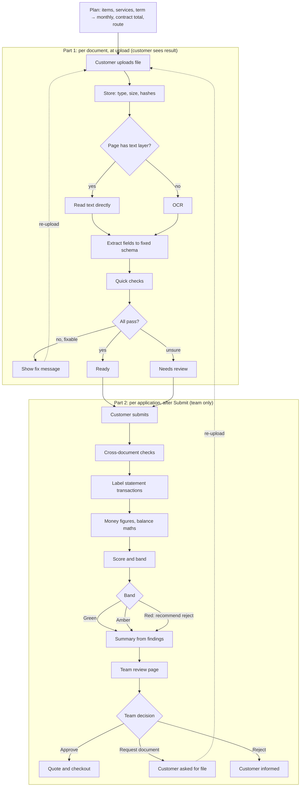

# Architecture

Principle: **AI reads, code decides, people approve.** AI is used only where rules cannot work: turning images into text, filling a fixed form from messy text, labelling bank transactions, and writing the summary. Every check, number, score and band is plain TypeScript.

## 1. Stack

Matches Revent Business so the module can move into their codebase later.

| Layer | Choice |
|---|---|
| App | One Next.js 16 app (App Router) on the Node.js runtime: pages are the frontend, route handlers are the backend. React 19, TypeScript (strict) |
| UI | Tailwind CSS v4, shadcn/ui, next-intl (EN + AR), next-themes |
| Data | Postgres via Drizzle ORM, versioned migrations only. PGlite locally; managed Postgres (Neon) when deployed |
| Files | `FileStore` interface. Local disk in dev, Cloudflare R2 when deployed, Replit Object Storage at Revent go-live (swap the implementation only) |
| PDF / images | pdf-lib (inspect PDFs), a PDF text extractor, sharp (re-encode photos, strip EXIF) |
| Validation | Zod at every boundary (API input, AI output, DB JSON) |
| Tests | Vitest (unit), Playwright (end-to-end) |
| AI | `OcrProvider` and `LlmProvider` interfaces. The concrete provider lives behind them and can be swapped |

## 2. Flow



AI steps: OCR, Extract fields, Label transactions, Summary. Everything else is code or people.

### Before KYC: plan and pricing

Pure functions in `src/plan/`, no AI.

- Prices are stored **per term** (24 / 36 / 48 months) for every product and service, not derived from a formula. They match the live site exactly.
- Line monthly = (product price + selected service prices) × quantity, all at the plan's term. Plan monthly = sum of lines. All in integer fils, excluding VAT.
- VAT (5%) is computed for display only. Contract total = plan monthly × term.
- Route = contract total below the threshold in `scoring_settings` → self-disclosure form; otherwise → verification call. Its basis (VAT, services) is an open question in the PRD.
- On Proceed, the application stores term, plan monthly, contract total and route. Part 2 uses the stored plan monthly for `leaseToIncome`.

### Part 1: per document, at upload

```
upload → store file (hash, size, type) → router → extract fields → quick checks → status
                                          │
                     text layer on page? ─┼─ yes → read text directly (free, exact)
                                          └─ no  → OCR
```

1. **Store.** Reject wrong type (checked by file content, not extension), over 10 MB, over 30 pages, password-protected, or containing scripts or attachments. Re-encode images with sharp. Save SHA-256 and a perceptual hash.
2. **Route per page.** Page has a text layer → read it. No text layer (photo, scan, image saved as PDF) → OCR.
3. **Extract.** The LLM fills a fixed Zod schema for the slot's document type. Every field carries `value`, `page`, `confidence`. Output that fails the schema = extraction failed → "Needs review".
4. **Quick checks** (section 3, stage `upload`).
5. **Status** = Ready / Needs a fix / Needs review (PRD §5).

### Part 2: per application, after Submit

```
cross-document checks → statement transactions → money figures → score + band → summary → review page
```

1. Cross-document checks (section 3, stage `submit`).
2. Bank statements: extract transactions with page and line text, label them (section 4), reconcile balances in code.
3. Compute money figures (section 4).
4. Score and band (section 5).
5. Summary: the LLM receives **only computed findings** (never raw documents) and fills a fixed schema. If it fails, a code template produces the summary instead.
6. Save the assessment. The team acts on the review page.

**Request document** → the customer gets a message → re-uploads → Part 1 runs → resubmits → Part 2 runs again. Old assessments are kept.

### Processing model (v1)

No job queue. Upload returns at once with status `processing`. The client calls `POST /api/documents/:id/process` and polls the status. Submit calls `POST /api/applications/:id/assess` the same way. A run that times out marks the item `failed` with a retry. Add a queue only if timeouts are seen in practice (log it in §9).

## 3. Check catalogue

Every check is one file in `src/kyc/checks/` and returns the same shape:

```ts
type CheckResult = {
  code: string;                       // e.g. "DOC_EXPIRED"
  status: "pass" | "warn" | "fail" | "skipped";
  detail: string;                     // plain English, for the team
  evidence?: { documentId: string; page: number };
  customerMessageKey?: string;        // i18n key, only if the customer can fix it
};
```

| Code | Stage | Rule | Fail means |
|---|---|---|---|
| `FILE_DUPLICATE` | upload | Same SHA-256 or near-identical perceptual hash already in this application | Needs a fix |
| `FILE_REUSED` | upload | Same SHA-256 seen in another customer's application | Warn → team |
| `DOC_UNREADABLE` | upload | Too little text, or image below minimum resolution / too blurry | Needs a fix |
| `DOC_WRONG_TYPE` | upload | Document fingerprints don't match the slot (e.g. no IBAN on a "statement", EID front in back slot) | Needs a fix |
| `DOC_EXPIRED` | upload | Expiry date before today | Needs a fix |
| `DOC_EXPIRES_SOON` | upload | Expires within 60 days | Warn → team |
| `ID_FORMAT` | upload | Emirates ID starts 784 (15 digits), TRN 15 digits, IBAN starts AE with valid checksum | Warn → team |
| `STMT_BALANCE` | upload | Each row: previous balance + in − out = balance; statement: opening + in − out = closing | Warn → team (could be misread or edited) |
| `STMT_COVERAGE` | upload | Statements together cover the 6 full months before the application | Needs a fix ("add October") |
| `STMT_CONTINUITY` | submit | Closing balance of month N = opening balance of month N+1 | Warn → team |
| `NAME_COMPANY` | submit | Company name matches across licence, tax certificate, statements and what was typed | Warn → team |
| `NAME_SIGNATORY` | submit | Signatory on licence matches passport and Emirates ID | Warn → team |
| `LICENCE_NUMBER` | submit | Licence number on document = number typed | Warn → team |
| `EMAIL_DOMAIN` | submit | Applicant's work email and signatory's signing email: domains match each other and relate to the company name. Free webmail (gmail, outlook…) is noted, not failed | Warn → team |

Name matching: lower-case, standard spellings (Mohammed / Muhammad / Mohd), drop legal suffixes (LLC, L.L.C., FZE, FZCO, DMCC), compare Arabic text when both sides have it. A name mismatch is never a hard stop.

## 4. Bank statements

**Transaction labels (v1):**

| Label | Used for |
|---|---|
| `customer_income` | Monthly income |
| `own_transfer_or_loan_in` | Excluded from income |
| `debt_repayment` | Existing monthly obligations (loans, other leases) |
| `returned_item` | Bounced cheques, returned direct debits |
| `other` | Ignored in v1 |

The LLM proposes a label per row. Code does all arithmetic.

**Money figures** (integer fils, per calendar month):

| Figure | Definition |
|---|---|
| `monthsCovered` | Full calendar months present |
| `avgMonthlyIncome` | Mean of monthly `customer_income` |
| `leaseToIncome` | Plan monthly amount ÷ `avgMonthlyIncome` |
| `lowestBalance` | Minimum daily closing balance |
| `daysBelowZero` | Days with closing balance < 0 |
| `returnedItems` | Count of `returned_item` |
| `existingDebtMonthly` | Mean monthly `debt_repayment` |

## 5. Scoring

Score 0–100, higher = safer. All weights and thresholds live in the `scoring_settings` table, versioned. Each assessment stores the settings version it used.

**Hard stops** (band is Red whatever the score): expired licence, `STMT_BALANCE` fail on more than one statement, `DOC_WRONG_TYPE` unresolved for a required document.

**Blocks (starting weights, to calibrate):**

| Block | Weight | From |
|---|---|---|
| Documents complete and readable | 15 | Upload checks |
| Identity and name consistency | 25 | `NAME_*`, `LICENCE_NUMBER`, `ID_FORMAT`, `EMAIL_DOMAIN` |
| Financial health | 50 | Money figures (thresholds in settings) |
| Statement integrity | 10 | `STMT_*` |

**Bands (starting values):** ≥ 75 Green · 50–74 Amber · < 50 Red ("Recommend reject"). If overall confidence < 0.7 → at least Amber.

**Output saved per assessment:**

```json
{
  "applicationId": "app_123",
  "score": 68,
  "band": "AMBER",
  "settingsVersion": 3,
  "confidence": 0.82,
  "hardStops": [],
  "blocks": { "documents": 0.9, "identity": 0.7, "financial": 0.6, "integrity": 1.0 },
  "reasons": [{ "code": "NAME_SIGNATORY", "status": "warn", "detail": "...", "evidence": { "documentId": "doc_9", "page": 1 } }],
  "figures": { "monthsCovered": 6, "avgMonthlyIncome": 4500000, "leaseToIncome": 0.004, "returnedItems": 2 },
  "summary": "...",
  "createdAt": "2026-11-10T10:15:00Z"
}
```

## 6. Data model

| Table | Holds |
|---|---|
| `products` | Name, category (Technology / Furniture / Office appliances), specs, `isDemoPrice` |
| `services` | Name, description |
| `prices` | Product or service, term (24 / 36 / 48), monthly fils |
| `applications` | Applicant (name, work email, mobile), company details typed, signatory name and signing email, term, plan monthly (fils), contract total (fils), route, status |
| `plan_items` | Application, product, quantity, selected services |
| `documents` | Slot, file key, hashes, page count, status, extracted fields (JSON) |
| `check_results` | One row per check per run |
| `transactions` | Date, description, in, out, balance, label, page |
| `assessments` | The output above |
| `review_actions` | Who, action, reason, timestamp |
| `scoring_settings` | Versioned weights and thresholds |

## 7. Folder layout

```
src/
  app/                    Next.js pages and route handlers only (thin)
    [locale]/plan/
    [locale]/kyc/                 hub
    [locale]/kyc/account/
    [locale]/kyc/company/
    [locale]/kyc/documents/
    [locale]/kyc/signatory/
    [locale]/kyc/self-disclosure/
    [locale]/kyc/review/
    team/applications/            list
    team/applications/[id]/       review page
    api/
  plan/                   Pricing and route. Pure TypeScript
  kyc/                    The module. Pure TypeScript, no Next.js imports
    intake/               store, hash, router
    extraction/           schemas per document type, OCR + LLM calls
    checks/               one file per check
    statements/           transactions, labels, figures
    scoring/              score, band, hard stops
    summary/              LLM summary + template fallback
  providers/              FileStore, OcrProvider, LlmProvider implementations
  db/                     Drizzle schema, migrations
    seed/                 catalogue, prices, scoring settings, demo scenarios
  messages/               en.json, ar.json
tests/
  fixtures/               synthetic documents only
  kyc/                    unit tests mirror src/kyc
  e2e/
```

Rule: `src/app` calls `src/plan` and `src/kyc`; neither imports from `src/app`.

Demo scenarios (for example: small plan with clean documents; plan over the route threshold with stretched finances; wrong document plus an edited statement) live only in `db/seed/` and `tests/fixtures/`. The pipeline treats them like any other application.

## 8. Evaluation

Run on the labelled test set (30–50 synthetic or anonymised documents, plus deliberately broken copies: one balance edited, a page missing, wrong document in a slot). One command, `npm run eval`, prints the table below. Results are recorded in the decision log whenever a provider, prompt or rule changes.

| Area | Metric | Plain meaning | v1 target |
|---|---|---|---|
| OCR | Character error rate (CER) | % of characters read wrong | < 2% digital PDFs, < 5% photos |
| Extraction | Field exact match | Licence no., TRN, names, dates exactly right | ≥ 98% digital, ≥ 90% photos |
| Extraction | Schema failure rate | AI output that didn't fit the schema | < 2% |
| Classification | Wrong-slot detection | Wrong document in a slot caught | ≥ 95% |
| Transactions | Row recall / row precision | Every row found / no invented rows | ≥ 99% / 100% after balance check |
| Transactions | Label accuracy | Correct label per row | ≥ 90% |
| Integrity | Tamper catch rate | Edited statements flagged | ≥ 90% |
| Integrity | False alarm rate | Clean documents wrongly flagged | < 10% |
| Summary | Faithfulness | Every number in the summary exists in the findings | 100% |
| Decision | Band agreement | Band matches the reviewer's judgement (shadow test) | ≥ 90% |
| Speed | Latency p50 / p95 per document | Time from upload to status | p95 ≤ 15 s |
| Speed | Latency per assessment | Submit to review page ready | ≤ 3 min |
| Cost | Cost per application | AI calls for one full application | Tracked; report per run |

Confidence calibration: fields reported with confidence ≥ 0.9 must be correct ≥ 99% of the time. If not, raise the threshold for "Needs review".

## 9. Decision log

How to use: when an approach is tried, add a row. Status moves `trying` → `adopted` or `dropped`, only after its test passes or fails. Never delete rows; dropped ideas stay as a record.

| # | Date | Decision | Why | Test / evidence | Status |
|---|---|---|---|---|---|
| 1 | 2026-11-10 | Read text-layer PDFs directly; OCR only image pages | Cheaper, exact numbers | Compare extraction on 10 digital statements | trying |
| 2 | 2026-11-10 | No job queue in v1 | Simplicity | Measure p95 processing time on deployed app | trying |
| 3 | 2026-11-10 | Summary from findings only, template fallback | No invented numbers | Every number in summary exists in findings | trying |
| 4 | 2026-11-10 | Store prices per term instead of a formula | Equipment follows ×0.72 / ×0.57 but services don't follow a clean factor | Seeded totals match live site examples (e.g. 2 items, 24 months = AED 551.05/mo; 36 = 403.76; 48 = 324.85) | trying |
| 5 | 2026-11-10 | Demo scenarios as seed data only | Results must come from the real pipeline | No scenario names or IDs anywhere in `src/` | trying |

## 10. Later (not v1)

- Investigator agent for Amber cases (read-only lookups, writes evidence notes).
- Follow-up agent that drafts document requests for a person to send.
- Weekly report comparing scores with team decisions to suggest threshold changes.
- Registry checks (licence, TRN) and bank connections instead of uploaded statements.
